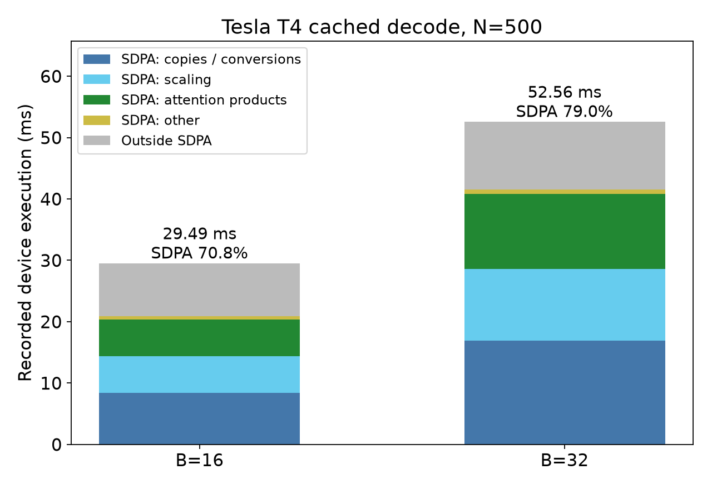
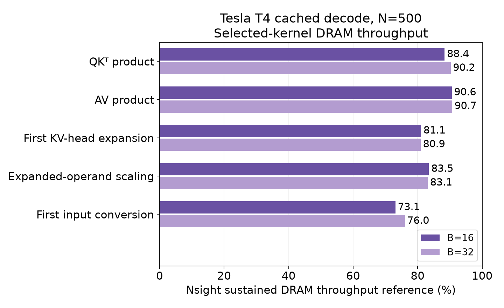

# Dunlin

[](https://github.com/mczhu/dunlin/actions/workflows/ci.yml)

**Measuring, understanding, and improving modern AI inference.**

Dunlin builds reproducible experiments to measure transformer inference
performance, explain its limits, and evaluate optimizations. It combines
benchmarks, execution profiling, and quantitative analysis to connect observed
performance to the work performed by the software and hardware.

Its central question is: **how much useful inference work can a given pool of
hardware deliver under latency, memory, and communication constraints?**

The first investigation examines Qwen2.5-0.5B-Instruct on a single NVIDIA T4.
It follows batching behavior through PyTorch execution and CUDA kernels to
hardware-counter measurements of memory traffic. This establishes a benchmark
and inference experiment workflow for later studies of serving, heterogeneous
resources, distributed execution, and sparse architectures.

## First investigation: from batching behavior to attention costs

**How do prefill and cached decode scale with batch size and context length,
and what explains weaker decode scaling at larger batches?**

Prefill processes the prompt; cached decode advances one token per request
using the saved KV cache. B denotes batch size, and N denotes prompt length.

**Key finding:** Cached decode scales efficiently at small batches ([Prefill and decode matrix](results/studies/prefill_decode_scaling.md)).
Throughput gains diminish substantially at larger batches ([Decode batch scaling](results/studies/decode_batch_scaling.md)). Profiling identifies
PyTorch's math attention backend, which executes attention through separate
operations and GPU kernels, as the dominant contributor to the added recorded
device execution between B=16 and B=32 ([Decode execution](results/studies/decode_execution.md)). Selected attention
kernels also run near Nsight's sustained DRAM throughput reference ([Attention bandwidth](results/studies/decode_attention_bandwidth.md)).
These findings support the hypothesis that DRAM bandwidth limits in the sampled
attention kernels contribute to weaker decode throughput scaling between B=16
and B=32.

In the following two plots we highlight results from two studies:
[Decode execution](results/studies/decode_execution.md) and
[Attention bandwidth](results/studies/decode_attention_bandwidth.md).




In [Decode batch scaling](results/studies/decode_batch_scaling.md), we observed that doubling batch size from B=16 to B=32 at N=500 yielded
only about 18% more throughput. The execution plot above shows that the same
batch-size increase nearly doubles execution time in the math attention path
(SDPA in the legend), while work outside attention grows much less. Attention
accounts for about 89% of the added recorded GPU execution, with copying and
scaling making up much of its cost. This identifies attention as the main path
to investigate when explaining the weaker throughput scaling. The plot covers
one profiled forward per batch, excluding gaps in device activity.



Copying moves tensor data, while scaling reads and writes tensor values. Their
large execution costs in the first chart motivated
[Attention bandwidth](results/studies/decode_attention_bandwidth.md), where we
tested the hypothesis that some expensive attention kernels are
memory-bandwidth-bound: limited by how quickly data moves to and from GPU
memory. The study sampled copies/conversions, scaling, and both attention
matrix products.

The chart above shows similar DRAM throughput percentages at B=16 and B=32
across all five sampled kernel types. The traffic and duration measurements in
[Attention bandwidth](results/studies/decode_attention_bandwidth.md#measured-traffic-and-duration)
also show that doubling the batch nearly doubles the data moved and execution
time. Together, these observations support a memory-bandwidth explanation for the observed attention
costs. The evidence is strongest for QKᵀ/AV, expansion, and scaling; conversion's
precise limit remains less certain.
These GPU hardware measurements come from
a separate Nsight Compute capture, with one selected launch per inferred
operation and batch.

The table below summarizes each step of the investigation, its main finding,
and the report containing the detailed measurements.

| Step | Finding | Report |
| --- | --- | --- |
| Map the behavior | Prefill throughput flattens for larger prompt workloads; cached decode scales nearly linearly through B=8. | [Prefill and decode matrix](results/studies/prefill_decode_scaling.md) |
| Extend decode batching | At N=500, doubling B=16 to B=32 gains only 18.2% and 18.6% throughput in independent pairs with opposite execution orders. | [Decode batch scaling](results/studies/decode_batch_scaling.md) |
| Inspect execution | PyTorch's math attention backend contributes about 89% of the added recorded device execution in the matched B=16/32 traces. | [Decode execution](results/studies/decode_execution.md) |
| Test a resource explanation | Selected launches mapped to QKᵀ and AV achieve about 285–291 GB/s and 88–91% of Nsight's sustained DRAM throughput reference. | [Attention bandwidth](results/studies/decode_attention_bandwidth.md) |

## Reproducible experiments and analysis

Dunlin provides a lightweight Python framework for repeatable inference
experiments and analysis. Shared utilities handle workload configuration,
device selection, source checks, and run artifacts. Separate analysis and
plotting tools use saved measurements to rebuild results.

The following two examples illustrate the workflow. Run commands from the
repository root.

### Explore the results

Install the locked dependencies and rebuild the prefill/decode matrix:

```bash
uv sync --locked

uv run --locked python experiments/plot_batch_context_matrix.py \
  results/published/20261003T150232Z_batch_context_matrix_9d7ad269 \
  --output runs/t4_matrix.png
```

The plotter validates the saved run records and recalculates the matrix from
individual timing samples, without a GPU or model weights. A companion source
record identifies the runs used to produce the figure.

### Run an experiment

From a clean Git checkout, run a short CPU smoke test:

```bash
uv run --locked python experiments/batched_forward_phases.py \
  --config configs/smoke_forward_phases.toml
```

The preset pins model/tokenizer revisions and workload settings. The run saves
its effective configuration, source commit, software/hardware environment, and
individual timing samples. This smoke test checks the workflow; its timing
protocol differs from the T4 study.

See the [reproduction guide](docs/reproduce.md) for setup, device selection,
source policy, and the full study workflows. The [artifact guide](docs/artifacts.md)
explains the run records, retained evidence, and provenance.

## Research directions

For limitations and possible follow-up studies, see the
[execution](results/studies/decode_execution.md#limits-and-next-question),
[bandwidth](results/studies/decode_attention_bandwidth.md#study-scope-and-limitations),
and [prefill/decode](results/studies/prefill_decode_scaling.md#interpretation-and-limits) reports.

Planned research directions include:

| Direction | Research question |
| --- | --- |
| Serving efficiency | How should requests be batched, scheduled, and routed to maximize useful throughput under latency constraints? |
| Distributed execution | When should computation be replicated, partitioned, or disaggregated across GPUs, accounting for memory and communication? |
| Sparse architectures | How do MoE routing, expert placement, and load imbalance affect hardware efficiency? |

Future comparisons will include heterogeneous GPUs and ordinary Ethernet where
useful. The current release contains single-GPU dense inference results.


## Layout

- `experiments/`: workload runners, capture tools, analysis, and plotting.
- `src/dunlin/`: shared workload, configuration, provenance, and metric utilities.
- [results/](results/README.md): four reports and the selected evidence needed to inspect them.
- `configs/`: pinned workload and smoke presets.
- `docs/`: reproduction instructions and experiment artifact definitions.
- `tests/`: correctness, metric, artifact, and source-policy checks.
- `runs/`: ignored outputs from new measurements and analyses.

## License

Copyright 2026 Mengchen Zhu.

Dunlin's original code, documentation, figures, and copyrightable benchmark
artifacts are licensed under the [Apache License, Version 2.0](LICENSE).
External libraries, model files, tools, and third-party material retain their
own terms; see [third-party components](THIRD_PARTY.md).
