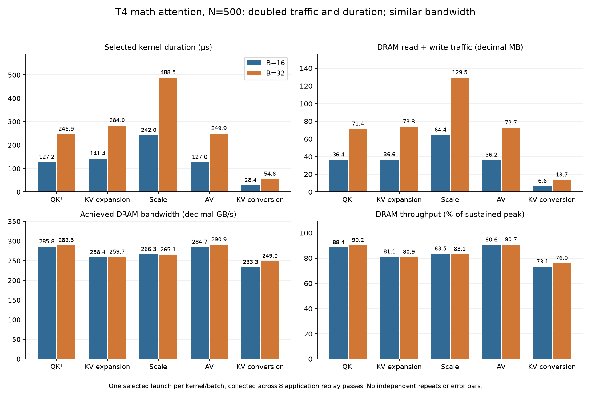

# T4 attention: a measured DRAM bandwidth explanation

**Question:** Does measured memory traffic explain the duration growth of the
attention kernels selected from the B=16/32 traces?

This follows the [execution study](decode_execution.md), which identified
costly execution in PyTorch's math attention backend. After inspecting those
traces, we declared the following competing hypotheses on October 10, before
the October 11 hardware-counter experiment.

## Hypotheses before counter collection

| Hypothesis | Expected supporting evidence | Evidence that would weaken it |
| --- | --- | --- |
| DRAM bandwidth governs kernel-duration growth | Traffic and duration grow together near sustained DRAM throughput. | DRAM has headroom while another resource shows stronger pressure. |
| Cache or memory-instruction throughput dominates | L2, L1/TEX, or memory-interface pressure with DRAM headroom. | The relevant cache/interface resources also have headroom. |
| Compute, conversion, or indexing throughput dominates | Compute or instruction pressure with memory headroom. | Memory throughput dominates instead. |
| Memory latency or insufficient parallel work dominates | Low throughput together with poor eligible-work or latency-hiding evidence. | Sustained throughput with adequate eligible work. |
| Attention dominance is capture-sensitive | A fresh confirmation changes the attention path or execution breakdown. | Confirmation retains the original observation. |

The selected counters can distinguish some of these resource explanations.
Eligible-work, detailed instruction/stall evidence, and fresh full-forward
confirmation would require additional diagnostics. The [comparison with
observations](#hypotheses-compared-with-observations) below retains those limits.
The logical MLP-versus-attention traffic models were added on October 12,
after counter collection; they are a later interpretation, rather than
pre-experiment predictions.

## Findings

**Selected `gemv2T_kernel_val` and `internal::gemvx::kernel` launches run near
Nsight's sustained DRAM throughput reference.** Doubling B=16 to B=32 nearly doubles their measured DRAM traffic
and duration while achieved bandwidth stays similar. Head expansion and large
scaling show a similar pattern with substantial DRAM throughput. Conversion
has more headroom, leaving its precise limiter less certain.

The counters support a resource explanation for the selected launches. They
do not establish attention's causal share of unprofiled whole-forward latency
or an optimization speedup.

## From kernel variants to inferred operations

The [execution study](decode_execution.md) identified expensive kernel variants
inside PyTorch's math attention backend, which executes attention through
separate operations and GPU kernels. This study measures counters for
selected launches of those variants. The names `qk`, `av`, `kv_expand`, `scale`,
and `kv_convert` are capture-script labels; the trace does not explicitly label
launches with these mathematical roles.

### Model and workload dimensions

The saved Qwen2.5-0.5B-Instruct [configuration](../published/20261010T131445Z_t4_decode_attribution_n500_profile_b16/config.resolved.json)
provides the dimensions used in the shape and traffic interpretations:

| Symbol | Meaning | Value |
| --- | --- | ---: |
| $B$ | Requests in the batch | $16$ or $32$ |
| $D$ | Hidden width | $896$ |
| $I$ | MLP intermediate width | $4864$ |
| $H_q$ | Query heads | $14$ |
| $H_{kv}$ | KV heads before expansion | $2$ |
| $d$ | Features per head | $64$ |
| $N$ | Cached prompt positions before decode | $500$ |
| $S$ | Positions attended to after adding the decode token, $N+1$ | $501$ |
| $L$ | Decoder layers | $24$ |

Thus $D=H_qd=896$ and $H_q/H_{kv}=7$: each KV head is expanded to seven
query heads in the inferred math-attention path. For one layer's cached-decode
step, the predicted logical tensor shapes are:

```math
\begin{aligned}
\mathrm{shape}(Q) &= [B,H_q,1,d], \\
\mathrm{shape}(K)=\mathrm{shape}(V) &= [B,H_{kv},S,d], \\
\mathrm{shape}(K_{\mathrm{expanded}})
  =\mathrm{shape}(V_{\mathrm{expanded}}) &= [B,H_q,S,d], \\
\mathrm{shape}(QK^\top)
  =\mathrm{shape}(\text{attention weights}) &= [B,H_q,1,S], \\
\mathrm{shape}(\text{attention weights}\times V_{\mathrm{expanded}})
  &= [B,H_q,1,d].
\end{aligned}
```

These are predicted logical shapes from the workload and implementation, not
shapes recorded by the profiler. Transposes and flattened batch/head dimensions
can change their representation inside a kernel.

### Selected launches and shape consistency

The selections target five intended first-layer launches, chosen from variants
covering 96.1%/97.5% of SDPA kernel-duration sums in the earlier traces. Those
shares cover all variant launches; the counters sample only one launch per
selection per batch.

| Selection | Recorded kernel marker | Inferred role | $B=16$ grid | $B=32$ grid | Matching launches skipped |
| --- | --- | --- | --- | --- | ---: |
| `qk` | `gemv2T_kernel_val` | First product: $QK^\top$ | `[63,1,224]` | `[63,1,448]` | 0 |
| `av` | `internal::gemvx::kernel` | Second product: attention weights $\times V$ | `[2,1,224]` | `[2,1,448]` | 0 |
| `kv_expand` | `elementwise_kernel` + `direct_copy_kernel_cuda` | First KV-head expansion, inferred K | `[28056,1,1]` | `[56112,1,1]` | 0 |
| `scale` | `AUnaryFunctor<float` + `MulFunctor<float` | Large expanded-operand scaling multiply | `[7014,1,1]` | `[14028,1,1]` | 3 |
| `kv_convert` | `unrolled_elementwise_kernel` + `direct_copy_kernel_cuda` | First large input conversion, inferred K, FP16→FP32 | `[2004,1,1]` | `[4008,1,1]` | 5 |

A CUDA grid counts thread blocks along its $x/y/z$ axes. Those axes describe
kernel work partitioning; they need not match tensor axes directly. See the
[CUDA programming model](https://docs.nvidia.com/cuda/cuda-programming-guide/01-introduction/programming-model.html#thread-blocks-and-grids).
The recorded geometry is arithmetically consistent with these logical shapes:

| Selection | Shape-consistency interpretation at $B=16$ |
| --- | --- |
| `qk` | Grid $z$ matches $BH_q=224$, consistent with one $z$-index per request/head product; grid $x$ is consistent with $\lceil S/8\rceil=63$ groups of score outputs. |
| `av` | Grid $z$ again matches $BH_q=224$; grid $x$ is consistent with $\lceil d/32\rceil=2$ groups of output features. |
| `kv_expand` | Expanded $K$ has $BH_qSd=7{,}182{,}336$ elements; $7{,}182{,}336/256=28{,}056$ blocks at the inferred $256$ elements per block. |
| `scale` | The same expanded element count at the inferred $1024$ elements per block gives $7{,}182{,}336/1024=7014$ blocks. |
| `kv_convert` | Unexpanded $K$ has $BH_{kv}Sd=1{,}026{,}048$ elements; $1{,}026{,}048/512=2004$ blocks at the inferred $512$ elements per block. |

At $B=32$, the batch-dependent grid dimension doubles for every selection.
The elementwise interpretations also fit the recorded templates and 128-thread
blocks: expansion uses `elementwise_kernel<128,2>`, conversion has an unroll
factor of four, and scaling's vectorized kernel is consistent with eight scalar
elements per thread. These agreements support conversion before head expansion
and scaling over an expanded operand. They do not independently prove those
operation identities or the scalar work assigned to each thread. In particular,
the proposed eight-score and 32-feature partitions for the cuBLAS products are
inferences; their internal indexing was not verified.

The earlier traces link GPU launches to owning CPU operators and their SDPA
ancestry through recorded IDs and correlations. Within that path, the first
`aten::bmm` product precedes softmax and the second follows it. Combined with the
captured implementation's operation order, this supports the QKᵀ/AV mapping.
Expansion and conversion roles likewise use operator ancestry and source/order
inference. Neither session recorded operand shapes, operand dtypes, or tensor
identity; kernel names and launch grids alone do not establish those roles.

**The operation-level interpretation assumes this mapping remains valid in the
counter capture.** Recorded workload compatibility and selected kernel names,
grids, and launch skips support that assumption. They do not independently prove
layer or tensor identity, and output correctness checks do not validate the
internal operation labels. The measured traffic, duration, and bandwidth apply
to the selected launches even if a role is misidentified; attributing those
measurements to QKᵀ, AV, K expansion, or conversion depends on the mapping.

Source: [October 11 capture configuration](../published/20261011T153633Z_t4_attention_bandwidth_2g0yi2bn/capture-config.json).
The [analysis summary](decode_attention_bandwidth/summary.json) and
[chart source record](decode_attention_bandwidth/attention_bandwidth.sources.json)
retain the quantitative results. Raw metric CSVs, selection records, warning
logs, commands, runtime metadata, and all 80 replay validation records support
the analysis.



Each bar describes one selected launch, collected through eight application
replay passes. Expansion and conversion select the first large launch, inferred
to operate on K; they do not combine K and V. There are no independent-repeat
distributions or error bars.

## Measured traffic and duration

Pairs below are **B=16 / B=32**. MB and GB use decimal units; ratios divide
B=32 by B=16.

| Selection | Duration µs | DRAM read + write MB | DRAM GB/s | Sustained DRAM % | Duration ratio | Traffic ratio |
| --- | ---: | ---: | ---: | ---: | ---: | ---: |
| `qk`: inferred QKᵀ | 127.23 / 246.88 | 36.36 / 71.41 | 285.79 / 289.26 | 88.37 / 90.23 | 1.940× | 1.964× |
| `kv_expand`: first head expansion | 141.44 / 284.00 | 36.56 / 73.75 | 258.45 / 259.70 | 81.07 / 80.93 | 2.008× | 2.018× |
| `scale`: large expanded-operand multiply | 241.98 / 488.54 | 64.44 / 129.50 | 266.30 / 265.07 | 83.49 / 83.13 | 2.019× | 2.010× |
| `av`: inferred attention weights × V | 127.01 / 249.86 | 36.16 / 72.69 | 284.69 / 290.92 | 90.56 / 90.69 | 1.967× | 2.010× |
| `kv_convert`: first large conversion | 28.45 / 54.85 | 6.64 / 13.65 | 233.26 / 248.96 | 73.11 / 76.01 | 1.928× | 2.058× |

| Selection | DRAM reads MB | DRAM writes MB | L2 throughput % | L2 sector hit % | L1/TEX throughput % | SM throughput % |
| --- | ---: | ---: | ---: | ---: | ---: | ---: |
| `qk` | 34.15 / 68.54 | 2.21 / 2.87 | 16.23 / 16.68 | 8.18 / 8.16 | 43.56 / 45.08 | 34.85 / 36.04 |
| `kv_expand` | 4.90 / 9.81 | 31.65 / 63.95 | 25.70 / 25.63 | 92.67 / 92.59 | 23.71 / 23.55 | 26.98 / 26.76 |
| `scale` | 32.73 / 65.35 | 31.71 / 64.15 | 15.33 / 15.18 | 50.05 / 50.04 | 13.35 / 13.28 | 1.82 / 1.81 |
| `av` | 35.46 / 71.31 | 0.70 / 1.38 | 15.11 / 15.36 | 2.90 / 2.78 | 11.98 / 12.05 | 11.91 / 11.97 |
| `kv_convert` | 2.68 / 5.32 | 3.96 / 8.34 | 14.53 / 14.79 | 67.76 / 67.24 | 16.49 / 16.93 | 22.21 / 22.80 |

The analyzer reads exported units and calculates bandwidth from the same report:

```text
DRAM GB/s = (dram__bytes_read.sum + dram__bytes_write.sum) / duration_ns
```

For QK B=16, `(34,153,280 + 2,207,840) / 127,232 = 285.79 GB/s`.
These bytes cross the DRAM interface under the capture conditions. They are
distinct from logical tensor sizes, allocation sizes, PCIe traffic, or a
whole-forward bandwidth average. A report combines metrics across replay
passes, rather than measuring all of them in one application execution.

`dram__throughput.avg.pct_of_peak_sustained_elapsed` and the L2/L1/SM
throughput rollups use Nsight sustained-peak references and the maximum
percentage of their constituent counters. They are not wall-time occupancy or
achieved FLOPs, and percentages across resources are not interchangeable. DRAM
percentages are preserved as exported rather than recalculated from an
advertised bandwidth. L2 sector hit rate is distinct from L2 throughput.

## Logical traffic models: MLP versus attention

Batching shares projection weights across requests, while each added request has
its own attention operands. This already predicts different traffic scaling.
Use $D=896$, $I=4864$, $H_q=14$, $d=64$ and $S=N+1=501$ from the saved
architecture/workload. The following per-layer models assume each logical input
is read once and each output written once. They describe operand traffic, not
measured DRAM bytes: caches, repeated kernel reads, temporary buffers and write
behavior can change the counter values.

### MLP projections: shared weights

For the FP16 down projection, let $s_m=2$ bytes per element:

```math
\begin{aligned}
T_{\mathrm{down}}(B)
  &= \underbrace{s_m ID}_{\text{fixed weights}}
   + \underbrace{s_m B(I+D)}_{\text{input read and output write}}, \\
T_{\mathrm{down}}(16) &= 8{,}900{,}608\ \mathrm{bytes}, \\
T_{\mathrm{down}}(32) &= 9{,}084{,}928\ \mathrm{bytes}, \\
\frac{T_{\mathrm{down}}(32)}{T_{\mathrm{down}}(16)} &\approx 1.021.
\end{aligned}
```

The weights contribute $8{,}716{,}288$ bytes at either batch size. Gate and up
have the same matrix size and input/output element counts as down, so the three
separate projections together have $T_{\mathrm{MLP\ projections}}(B)=3T_{\mathrm{down}}(B)$:
26.702 / 27.255 decimal MB, also a 1.021× ratio. This excludes activation functions,
the gate/up elementwise product and other decoder work. Their modeled FLOPs double
with batch size even though their weight matrices do not grow. **Sublinear MLP
traffic is therefore an expectation under this reuse model; it has not been
verified by MLP DRAM counters here.**

### Attention products: request-specific operands

For the captured math-SDPA path, model materialized KV expansion to $H_q$ heads
and FP32 product operands with $s_a=4$ bytes per element. These are the existing
[source/order inferences](#from-kernel-variants-to-inferred-operations),
supported by [PyTorch's pinned math implementation](https://github.com/pytorch/pytorch/blob/v2.13.0/aten/src/ATen/native/transformers/attention.cpp#L798-L858),
not recorded operand-dtype measurements. The read-once/write-once counts are:

```math
\begin{aligned}
T_{QK^\top}(B)
  &= s_a B H_q\bigl(\underbrace{d}_{Q}
     + \underbrace{dS}_{K^\top}
     + \underbrace{S}_{\text{scores}}\bigr), \\
T_{AV}(B)
  &= s_a B H_q\bigl(\underbrace{S}_{\text{attention weights}}
     + \underbrace{Sd}_{V}
     + \underbrace{d}_{\text{output}}\bigr), \\
\frac{T_{QK^\top}(32)}{T_{QK^\top}(16)}
  &= \frac{T_{AV}(32)}{T_{AV}(16)} = 2.
\end{aligned}
```

Each product has 29.236 / 58.471 decimal MB of logical operand traffic at
B=16/32. This excludes expansion, conversion, scaling and softmax traffic;
it is not a total-SDPA model. The expanded head count is specific to this
implementation: a backend that consumes the two KV heads directly can have a
different traffic model.

| Scope | Logical traffic B=16 / B=32, MB | Modeled ratio | Measured DRAM ratio |
| --- | ---: | ---: | ---: |
| MLP down projection | 8.901 / 9.085 | 1.021× | Not measured |
| Three MLP projections | 26.702 / 27.255 | 1.021× | Not measured |
| Sampled QKᵀ product | 29.236 / 58.471 | 2.000× | 1.964× |
| Sampled AV product | 29.236 / 58.471 | 2.000× | 2.010× |

**Only attention has empirical DRAM-scaling evidence in this comparison.**
Its sampled product ratios agree approximately with the modeled twofold growth;
the absolute measured bytes exceed the logical counts. This supports the scaling
prediction, not exact agreement with a one-read/one-write DRAM model. The MLP model
is sufficient for the present explanatory contrast, so MLP counter collection
is deferred; no MLP measurements were collected. A future measurement would
test actual weight reuse and kernel efficiency, rather than establish the basic
shape prediction. Neither model establishes a duration ratio, a whole-MLP
bottleneck or the cause of outside-attention timing growth.

## Explanation and alternatives

**The two product variants, mapped to QKᵀ and AV, provide the strongest bandwidth evidence.** Their DRAM-read-heavy
traffic achieves about 285–291 GB/s and 88–91% of sustained DRAM throughput.
Low L2 hit rates, modest L2 throughput, and lower SM throughput favor a DRAM
limit over compute or L2 saturation. Traffic grows 1.96×/2.01× while duration
grows 1.94×/1.97×; bandwidth changes about 1–2%.

**Expansion is predominantly a write stream.** About 87% of DRAM bytes are
writes, consistent with materializing expanded heads. Its 92.6% L2 sector hit
rate coexists with roughly 81% DRAM throughput: source reuse does not remove
output writes. L2 throughput is about 26%, so hit rate alone does not support
an L2 throughput bottleneck. Traffic and duration both grow about 2.01× at
approximately 259 GB/s.

**Large scaling moves more DRAM data than either sampled product.** It reads
and writes about 32 MB each at B=16 and 64 MB each at B=32, with only about
1.8% SM throughput. Roughly 83% DRAM throughput and stable 265–266 GB/s
favor data movement as the dominant cost. The operation scales a large expanded
operand, rather than a small score vector.

**Conversion remains less conclusive.** DRAM throughput is 73–76%, with
L2/L1/SM throughput below 23%. This favors traffic over compute saturation,
but leaves mixed conversion/instruction/latency costs unresolved. Bandwidth
rises about 6.7% at B=32; duration grows 1.93× against 2.06× traffic. One
sample per batch cannot establish whether that difference repeats.

### Hypotheses compared with observations

The [pre-counter hypotheses](#hypotheses-before-counter-collection) compare
with the observed counters as follows:

| Hypothesis | Observation and remaining test |
| --- | --- |
| DRAM bandwidth governs growth | Nearly doubled traffic and duration at high, similar DRAM throughput, strongest for QK/AV. A matched traffic-reducing implementation comparison would test causality. |
| Cache or memory-instruction throughput dominates | L2 is 14.5–25.7% and L1/TEX at most 45.1%; no sampled rollup favors cache saturation over DRAM. Detailed constituent counters could resolve a specific interface question. |
| Compute/conversion/indexing throughput dominates | SM throughput is at most 36.0%, below DRAM. Compute saturation is unsupported; conversion may have mixed costs. Instruction/stall details are absent. |
| Memory latency or insufficient parallel work dominates | High DRAM throughput weakens a pure low-throughput explanation for the four larger selections. Occupancy/eligible-warp/stall evidence was not collected. |
| Attention dominance is capture-sensitive | Names, grids, runtime, and output checks match, but selected counters do not reconfirm the full attention breakdown or unprofiled importance. A matched full trace would test that stronger claim. |

## Study scope and limitations

The evidence covers one selected launch per inferred operation and batch size,
with no independent repeats or fresh full-forward confirmation. Coverage excludes
other layers, V copies, smaller conversions, softmax, non-attention work, and
execution gaps. These counters cannot be extrapolated across all layers or
averaged into model-wide utilization; kernel-duration ratios do not establish
attention's contribution to unprofiled forward latency.

Caches and clocks were uncontrolled, and performance stability across replay
passes was not measured. The bandwidth explanation is strongest for the selected
QKᵀ/AV products, expansion, and scaling; conversion's precise limit remains
uncertain. A controlled implementation comparison would test whether reducing
traffic improves unprofiled forward latency.

## Artifacts and validation

The capture uses eager Qwen2.5-0.5B-Instruct on a T4 with FP16 model inputs,
N=500, and B=16/32. Each measured forward advances one cached-decode token;
fresh-cache preparation and five phase warm-ups precede capture. PyTorch
profiling is disabled during counter collection.

Nsight selects one matching launch in the second `cached_decode_forward/`
range using application replay. Ten selections each require eight replay passes:
**80 validated replay workloads**, not 80 independent performance samples.

The analyzer checks every replay's completion, finite logits, fresh-cache
reference agreement, and cache length 500→501. It also checks workload/source
compatibility, replay counts, and kernel names/grids against the saved selection
configuration. These checks validate the workload and selection; they do not
establish performance stability or repeat the full-forward timing comparison.

Exact workload settings, runtime metadata, source identities, selectors, and
commands are recorded in the
[saved configuration](../published/20261011T153633Z_t4_attention_bandwidth_2g0yi2bn/capture-config.json)
and session/replay artifacts. The [artifact guide](../../docs/artifacts.md#attention-counter-captures)
explains those records and the retained evidence. The historical capture predates
current source-boundary checks, and its configuration was
[reconstructed after collection](../../docs/artifacts.md#historical-configuration).
The [reproduction guide](../../docs/reproduce.md#collect-new-attention-counters)
describes the workflow for new captures.

## Operation mapping

The [opening mapping section](#from-kernel-variants-to-inferred-operations)
consolidates the inferred roles, model dimensions, recorded grids, and skip
counts. The following details explain launch selection and trace ownership.

These abbreviated markers are explanatory; exact regular expressions and
capture options are in the [saved configuration](../published/20261011T153633Z_t4_attention_bandwidth_2g0yi2bn/capture-config.json).
Scale skips two rotary operations and small query scaling. Conversion skips
four preceding copies outside SDPA and the small query conversion. Selection
validation checks the exported name/grid; if launch order changes, matching
those alone cannot establish layer or tensor identity.

`kv_expand` is a script label for an `aten::copy_` under
`SDPA → math SDPA → repeat_interleave → clone → copy_`. In the B=16 trace,
the first expansion has External id 5801 and correlation 35662. The first
large conversion has External id 5786 and correlation 35621, under
`to → _to_copy → copy_`. Naming them K, and naming the conversion FP16→FP32,
uses the original source/order inference for the captured PyTorch implementation
and workload. Neither session recorded operand shapes/dtypes or tensor identity.
Counter collection uses Nsight launch selection rather than these PyTorch IDs.

## Rebuild the analysis

```bash
uv run --locked python experiments/analyze_attention_bandwidth.py \
  results/published/20261011T153633Z_t4_attention_bandwidth_2g0yi2bn \
  --require-strict --output-dir runs/t4_bandwidth_analysis

uv run --locked python experiments/plot_attention_bandwidth.py \
  runs/t4_bandwidth_analysis/summary.json \
  --output runs/t4_bandwidth_analysis/attention_bandwidth.png
```

Choose a new output directory for another run. The standard-library analyzer
validates replay/kernel/workload compatibility and hashes consumed artifacts;
the Matplotlib plotter reads its summary. Neither requires a GPU, Nsight, model
weights, original host paths, or historical Git source. `--require-strict`
rejects debug inputs while retaining all evidence validation.
