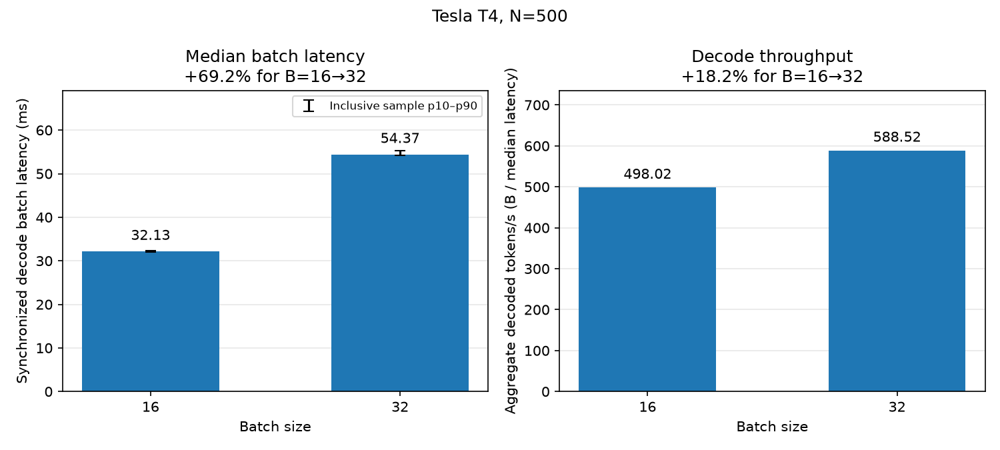

# T4 cached-decode batch scaling at N=500

**Question:** Does cached-decode throughput continue to scale beyond batch eight
at a fixed 500-token context?

**Decode throughput gains weaken between B=16 and B=32.** Two separately run
pairs with opposite execution orders gain 18.2% and 18.6% throughput while batch
latency rises about 69%. The preceding B=8/16 anchor gains 79.3% throughput.
These observations select B=16/32 for diagnostic attribution. They establish a
repeatable weakened-scaling interval; its resource mechanism remains unresolved.

Measurements: October 9, 2026. This follows the
[prefill/decode matrix](prefill_decode_scaling.md).
That matrix found near-linear decode scaling through B=8, but measured both
phases. The extension starts from a fresh decode-only anchor so the different
phase history remains explicit.

## Samples and gains

All rows have 30 samples. p10–p90 are inclusive sample percentiles, rather than
confidence intervals. Each link opens the raw `measurements.csv`.

| Series | Batch | Median latency ms | p10–p90 ms | Aggregate tokens/s | Raw samples |
| --- | ---: | ---: | ---: | ---: | --- |
| Anchor extension | 8 | 28.467 | 28.191–29.041 | 281.03 | [Anchor B=8](../published/20261009T200203Z_t4_decode_n500_b8/measurements.csv) |
| Anchor extension | 16 | 31.750 | 31.529–32.151 | 503.94 | [Anchor B=16](../published/20261009T200203Z_t4_decode_n500_b16/measurements.csv) |
| Reverse order | 16 | 32.612 | 32.402–32.977 | 490.62 | [Reverse B=16](../published/20261009T213223Z_t4_decode_n500_repeat_b16/measurements.csv) |
| Reverse order | 32 | 54.997 | 54.459–55.588 | 581.85 | [Reverse B=32](../published/20261009T213223Z_t4_decode_n500_repeat_b32/measurements.csv) |
| Forward order | 16 | 32.127 | 31.971–32.390 | 498.02 | [Forward B=16](../published/20261009T215054Z_t4_decode_n500_b16/measurements.csv) |
| Forward order | 32 | 54.373 | 54.238–55.304 | 588.52 | [Forward B=32](../published/20261009T215054Z_t4_decode_n500_b32/measurements.csv) |

| Series | Doubling | Throughput gain | Latency increase | Gain <10% | Gain <25% | Gain <50% |
| --- | --- | ---: | ---: | --- | --- | --- |
| Anchor | 8→16 | 79.3% | 11.5% | No | No | No |
| Reverse order | 16→32 | 18.6% | 68.6% | No | Yes | Yes |
| Forward order | 16→32 | 18.2% | 69.2% | No | Yes | Yes |

The B=16 medians differ by 1.5% between pair studies, and the B=32 medians by
1.1%, relative to the forward-order study. Gains differ by 0.42 percentage
points. The contrast persists across these shifts and opposite orders; the
within-study latency spreads are well separated. Two pairs do not fully control
clocks, temperature, background load, or time-dependent drift, and supply no
statistical confidence estimate.

The fresh B=8 median is about 9.1% lower than the matrix's both-phase B=8
median of 31.30 ms. The matrix remains a separately labeled history control.
Its samples are not pooled with the extension, nor are independent pair studies
pooled into one curve.



## Decision and remaining question

Both B=16/32 studies satisfy the 25% weakened-gain criterion. Neither meets
the 10% criterion, and no second adjacent doubling exists: a plateau remains
unestablished. Shape-dependent execution, memory traffic, compute cost, and
submission overhead remain alternatives that scaling alone cannot distinguish.

The selected pair supports the next question: **which execution costs grow?**
The [execution report](decode_execution.md) uses matched diagnostic traces,
whose timings remain separate from these benchmark samples. The retained
samples and metadata are described in
[the artifact guide](../../docs/artifacts.md#what-the-release-includes).

## Study scope and limitations

The retained runs form three separate comparisons: a B=8/16 anchor and two
B=16/32 pairs with opposite execution orders. The reverse-order pair ran before
the forward-order pair, so the records do not document an ascending candidate
followed immediately by its reverse repeat. The anchor and pair studies cannot
be combined into one source-matched B=8/16/32 curve.

B=64 was not measured, and the retained runs do not locate a memory-capacity
limit. The results establish a weakened-scaling interval; the plateau criterion
remains unmet. The limits on controlling drift and estimating confidence are
described alongside the samples above.

## Workload and predeclared criteria

All points use Qwen/Qwen2.5-0.5B-Instruct, model/tokenizer revision
`7ae557604adf67be50417f59c2c2f167def9a775`, on native Linux/Tesla T4 with
CUDA float16. Execution is eager and uncompiled, with SDPA attention,
`eval()` / `inference_mode()`, `use_cache=True`, and `logits_to_keep=1`.
The identical repeated city-planning requests are Qwen chat-formatted and
left-truncated to N=500; prompt and token-ID hashes match across the runs.
Each point has five warm-ups and 30 measured forwards in a fresh process.

Latency is synchronized wall-clock model-forward time. Each measurement
advances one decoded position per request, with cache length 500→501. Loading,
tokenization, transfer, and fresh prompt prefill are outside timing; cache
updates are inside. Throughput R(B) is B divided by median latency in seconds.
The gain on doubling is R(2B)/R(B) − 1. These are forward throughput and latency,
rather than serving throughput or generation inter-token latency.

Before measurement, the design declared gain **below 25% plus rising batch
latency** a weakened-scaling candidate, with sensitivity at 10%, 25%, and 50%.
It reserved a plateau claim for gains below 10% on two successive doublings,
supported by independent replication. The retained comparisons and deviations
from the intended measurement sequence are summarized in
[Study scope and limitations](#study-scope-and-limitations).

## Artifacts and validation

Workload settings, runtime metadata, source identities, and completion status
are recorded in the run artifacts; the
[artifact guide](../../docs/artifacts.md#shared-run-records) explains how to inspect them.
The [anchor](../published/20261009T200203Z_t4_decode_n500_scaling_b16/summary.json),
[reverse-order](../published/20261009T213223Z_t4_decode_n500_repeat_scaling/summary.json),
and [forward-order](../published/20261009T215054Z_t4_decode_n500_scaling_b32/summary.json)
analysis summaries collect results and recorded provenance for each comparison.

The timing runs check cache lengths but do not retain full B=16/32
output-reference checks; cache lengths alone do not establish output agreement.
The [B=8 diagnostic validation](../published/20261009T200203Z_t4_decode_n500_b8_check/validation.json)
is excluded from timing, and later [matched B=16/32 traces](decode_execution.md)
provide separate passed correctness checks.

## Rebuild the analysis

From the repository root, analyze the forward pair in execution order:

```bash
uv run --locked python experiments/analyze_decode_scaling.py \
  results/published/20261009T215054Z_t4_decode_n500_b16 \
  results/published/20261009T215054Z_t4_decode_n500_b32 \
  --require-strict --output-dir runs/t4_scaling_forward

uv run --locked python experiments/plot_decode_scaling.py \
  runs/t4_scaling_forward/summary.json \
  --output runs/t4_scaling_forward/scaling.png
```

Analyze the anchor B=8 then B=16, and the reverse pair B=32 then B=16,
separately into new output directories. The analyzer rebuilds median, percentiles,
throughput, gains, and threshold flags from CSVs while validating within-series
workload/environment/source compatibility. No inference is performed.
