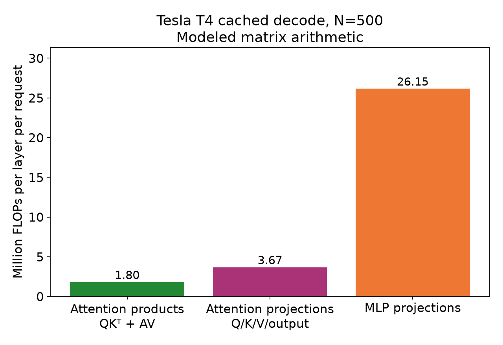

# T4 decode execution: where does the added work go?

**Question:** Which recorded execution costs grow when batch size doubles from
16 to 32 at N=500?

**PyTorch's math attention backend accounts for about 89% of the added
recorded device execution between B=16 and B=32.** It executes attention through
separate operations and GPU kernels. It dominates the matched
diagnostic traces despite less modeled matrix arithmetic than the MLP. Copying,
scaling, and attention products are the main costs. This selects kernels for
the [bandwidth follow-up](decode_attention_bandwidth.md).

The preceding [scaling study](decode_batch_scaling.md) found only 18.2%/18.6%
throughput gains on this doubling. Traces identify a costly execution path;
their timing behavior differs from the unprofiled benchmarks, so the diagnostic
shares do not establish attention's causal contribution to benchmark latency.

## Execution and gaps

<a href="decode_overview/execution.png"></a>

This plot partitions recorded device execution, excluding gaps.

| Metric | B=16 | B=32 |
| --- | ---: | ---: |
| Diagnostic completion window W | 53.914 ms | 58.897 ms |
| Recorded forward device activity U | 29.493 ms | 52.559 ms |
| Forward activity gaps G = W − U | 24.421 ms | 6.339 ms |
| Device activity inside SDPA | 20.889 ms | 41.514 ms |
| SDPA share of device activity | 70.8% | 79.0% |
| Device activity outside SDPA | 8.604 ms | 11.045 ms |
| Internal gaps summed within 24 SDPA device spans | 1.036 ms | 0.372 ms |

| Device execution attributed to operators inside SDPA | B=16 | B=32 |
| --- | ---: | ---: |
| `aten::copy_`: copies and dtype conversions | 8.438 ms | 16.870 ms |
| `aten::mul`: scaling | 5.928 ms | 11.724 ms |
| `aten::bmm`: QKᵀ and AV | 6.004 ms | 12.251 ms |
| Other SDPA work, including softmax | 0.520 ms | 0.668 ms |

Copying and scaling account for about 69% of SDPA execution. From B=16 to
B=32, their duration ratios are 2.00× and 1.98×; the attention products grow
2.04×. These are two-point observations rather than general scaling laws.


The screenshot illustrates part of the B=16 capture: nested CPU SDPA operators,
the math backend, and a dense GPU kernel region. Its flow arrow links a selected
host operation to device execution. The numerical tables come from the complete
traces, rather than measurements of the screenshot. Horizontal alignment alone
does not establish ownership.

## Attention path and kernel selection

The CPU sequence includes `to → _to_copy`, two KV-head
`repeat_interleave → clone → copy_` expansions, separate multiplication,
two attention `bmm` calls, and softmax. Float copy/multiply and GEMV-like
product kernel names support PyTorch's math attention backend executing
separate operations and GPU kernels with FP32 work under FP16 model execution. The trace does not establish why that backend was
selected, nor does it measure traffic or operand dtypes.

The kernel-level analysis of these same traces groups variants by full kernel
name, grid, block, SDPA membership, and CPU ancestry. It separates large and
small launches sharing names and preserves the first SDPA call's launch order
and correlations. Ranking uses summed kernel duration across all 24 layers:

| Largest attention variants | Calls per forward | B=16 ms | B=32 ms |
| --- | ---: | ---: | ---: |
| Expansion copy under `repeat_interleave → clone → copy_` | 48 | 6.701 | 13.672 |
| Large scaling multiply | 24 | 5.865 | 11.640 |
| First product: `gemv2T_kernel_val` | 24 | 3.287 | 6.456 |
| Second product: `internal::gemvx::kernel` | 24 | 2.717 | 5.794 |
| Large conversion under `to → _to_copy → copy_` | 48 | 1.510 | 2.928 |

These variants account for 96.1%/97.5% of SDPA kernel-duration sums. Duration
sums can count concurrent execution twice; measured overlap is negligible here.
Shares exclude gaps and non-kernel events. Expansion/conversion rows combine
both launches per layer. Identifying the first as K and second as V relies on
the source/order inference recorded in the original study, rather than measured
tensor identity. The [counter report](decode_attention_bandwidth.md#operation-mapping)
documents the selected names, skips, grids, and mapping limits.

## Work model and interpretation

<a href="dense_execution_attention/matrix_arithmetic.png"></a>

The plot groups modeled FLOPs into attention products (QKᵀ and AV), attention
projections (Q/K/V and output), and MLP projections (gate/up and down). These
are operation categories, not trace-derived kernel totals.

Saved architecture dimensions are hidden width D=896, MLP width I=4864,
Hq=14 query heads, Hkv=2 KV heads, head width d=64, and decode cache length
S=501. With a multiply-add counted as two FLOPs:

| Leading matrix work per layer per request | FLOP expression | FLOPs |
| --- | --- | ---: |
| QKᵀ and AV | 4×Hq×d×S | 1,795,584 |
| Q/K/V/output projections | 4×D×d×(Hq+Hkv) | 3,670,016 |
| Gate/up/down MLP projections | 6×D×I | 26,148,864 |

Multiply by B for a layer's batch work, or B×24 for all decoder layers. This
excludes softmax, elementwise work, and the once-per-forward vocabulary head.
The MLP's predicted arithmetic is about 14.6× the attention products'. Shapes
were not recorded in these captures; the expressions are logical predictions
from architecture/workload metadata.

High duration need not follow high FLOP count. One query row per head attends
to 501 positions through separate copies, scaling, and GEMV-like products;
projections use different matrix paths. Traffic, precision, launch costs, and
shape efficiency are competing explanations for time per modeled FLOP.

Device activity increases 23.065 ms on doubling: SDPA adds 20.624 ms and
outside-SDPA work adds 2.441 ms. Gaps decrease 18.082 ms, leaving only
4.983 ms of diagnostic W growth (ΔW=ΔU+ΔG). The unprofiled baseline medians
are 32.127/54.373 ms, a much larger relative latency increase. Diagnostic
growth therefore does not quantitatively attribute the unprofiled contrast.

Longer attention kernels may let the CPU queue subsequent work, while shorter
outside-attention kernels expose late submission. This remains a hypothesis:
dependencies, scheduling, and diagnostic overhead are alternatives. Testing it
requires correlated launch timing against the preceding device event, retaining
bounds where the enqueue instant is ambiguous.

### Hypothesis: why projection time may grow less

Batching may improve weight reuse and GEMM efficiency for MLP projections while
the selected attention path incurs traffic that grows nearly proportionally
with batch size. A projection computes `[B,D] × [D,I]` using one shared weight
matrix. Doubling B doubles its arithmetic without doubling that matrix. If the
kernel reuses weights effectively, its duration can grow less than its FLOP
count, even when weight access remains a limiting cost. NVIDIA's
[matrix multiplication guide](https://docs.nvidia.com/deeplearning/performance/dl-performance-matrix-multiplication/index.html)
explains how tiling, reuse, and matrix shape affect GEMM efficiency.

Cached-decode attention instead retains one query row per request and head
against 501 cached positions. Adding requests increases the number of these
products and their cache data without widening that one-row query dimension.
The trace shows separate expansion copies, scaling, and float GEMV-like
products. The [counter follow-up](decode_attention_bandwidth.md) observes nearly
doubled traffic and duration for selected launches. The trace ranking also
contains FP16 Tensor Core GEMM kernel names outside SDPA, supporting a different
execution-path hypothesis for projections; it does not individually establish
which launches belong to the MLP or measure their Tensor Core utilization.

This is a hypothesis for the contrast, not an established MLP resource diagnosis.
The 2.441 ms increase outside SDPA includes projections, the vocabulary head,
cache updates, and other work. The study did not measure MLP traffic or resource
counters. The [logical traffic models](decode_attention_bandwidth.md#logical-traffic-models-mlp-versus-attention)
predict 1.021× operand traffic for the three FP16 MLP projections versus 2×
for each inferred expanded FP32 attention product on this batch doubling.
Only attention has measured DRAM-scaling evidence. MLP counter collection is
deferred; a future capture of identified gate/up/down kernels would test actual
weight reuse and kernel efficiency. The chart's FLOP comparison also excludes
attention copies and scaling,
although those operations contribute substantially to its measured time.

## Limits and next question

Only one saved trace per batch and one illustrative screenshot are retained.
There were no independent confirmation traces, shape/dtype pass, or allocation
diagnostics. The timing study's chronology and missing budget/memory records
remain limitations. Neither attention's unprofiled share nor the source of all
gaps is resolved by this observation.

The next question is whether the costly selected kernels show DRAM, cache,
compute, or latency pressure. The [bandwidth report](decode_attention_bandwidth.md)
tests that question with counters; a controlled implementation comparison would
still be needed for causal whole-forward attribution. A comparison of math and
fused attention implementations should measure unprofiled forward latency and
batch scaling, with matched traces to explain changes in the execution path. See
[the artifact guide](../../docs/artifacts.md#what-the-release-includes) for the
included evidence.

## Matched captures and validation

Sources: the [B=16 manifest](../published/20261010T131445Z_t4_decode_attribution_n500_profile_b16/manifest.json)
and [B=32 manifest](../published/20261010T131445Z_t4_decode_attribution_n500_profile_b32/manifest.json).
Each directory retains `trace.json`, `config.resolved.json`, `environment.json`,
and `validation.json`. One diagnostic forward per batch was saved on October 10,
2026, using native Linux/Tesla T4, eager Qwen2.5-0.5B-Instruct, FP16,
PyTorch 2.13.0+cu130, Transformers 5.16.1, N=500, one cached-decode token,
and `logits_to_keep=1`. Model/tokenizer revision is
`7ae557604adf67be50417f59c2c2f167def9a775`.

The recorded capture source is clean at
`75d80e5b75bb9cc6e2b82346494b9ba5b2a50359`. Environment records match exactly;
configs differ only in batch size and linked baseline/config paths. Both
validations pass finite `[B,1,151936]` logits, fresh-cache reference agreement,
profiled/unprofiled agreement, and cache length 500→501. Shape, stack, and
memory recording were disabled. The analysis retains capture metadata and
input hashes separately from its own source and environment.

The [complete analysis summary](dense_execution_attention/summary.json) and
[execution plot source record](decode_overview/execution.sources.json) and
[arithmetic plot source record](dense_execution_attention/matrix_arithmetic.sources.json)
support the figures. Kernel rankings can be regenerated from the same traces;
their redundant standalone snapshot is omitted from the release.

## Timing and attribution method

W spans host `cached_decode_forward` entry through the following
`wait_for_completion` exit. U is the union of correlated kernel/copy/memset
execution intervals; G is the remainder, including boundary time. These are
time-accounting measures: U does not measure hardware utilization, and G does
not establish that unrelated GPU work was absent.

The [analyzer](../../src/dunlin/trace_attention.py) uses each complete device
event's `[ts, ts + dur)` interval in microseconds. It matches the event's
`External id` to its owning CPU operator inside the host forward, then checks
whether that operator is nested inside an SDPA call on the same host thread.
GPU execution can occur after the CPU SDPA interval; timestamp overlap with
that CPU interval is not the ownership rule. For manual inspection, a device
event's `correlation` links it to the CPU launch; its owning operator and ancestry
identify the associated work.

Each event enters one group: copies, scaling, products, other SDPA work, or
outside-SDPA work. Parent operations do not also receive their children's
durations. Groups use interval unions; the analyzer reports cross-group overlap
and the stacked plot rejects overlapping partitions. These single-stream
captures have negligible measured overlap. CPU/launch durations, annotations,
and flow arrows are excluded from U.

Each capture has 24 SDPA calls with 384 associated device events. There are
1,346/1,418 selected device events overall, on device 0/context 1/stream 7
(IDs local to these captures). All selected events map to CPU operators and
fit within W, with no unattributed activity in that window. SDPA device spans
are about 95.3%/99.1% covered by their own execution. The analyzer rejects
missing markers, duplicate/ambiguous IDs, and events escaping W, allowing
0.01 µs for exported host-interval rounding.

Attribution follows the recorded owning operator. A fused kernel's entire
interval belongs to that operator; its internal mathematical work cannot be
split using timestamps. The separate kernels here support this breakdown.
A fused attention backend would enter the other-SDPA group.

## Rebuild the analysis

```bash
uv run --locked python experiments/analyze_trace_attention.py \
  results/published/20261010T131445Z_t4_decode_attribution_n500_profile_b16 \
  results/published/20261010T131445Z_t4_decode_attribution_n500_profile_b32 \
  --output-dir runs/t4_attention_analysis

uv run --locked python experiments/plot_trace_attention.py \
  runs/t4_attention_analysis/summary.json \
  --panel execution --require-strict \
  --output runs/t4_attention_analysis/execution.png

uv run --locked python experiments/plot_trace_attention.py \
  runs/t4_attention_analysis/summary.json \
  --panel arithmetic --require-strict \
  --output runs/t4_attention_analysis/matrix_arithmetic.png
```

The analysis reads saved artifacts with Python's standard library; plotting
uses Matplotlib. No model or CUDA execution is needed. The output includes a
complete `summary.json`, `kernel_ranking.md`, and per-capture variant CSVs.
The trace analyzer has no `--require-strict` option; official use additionally needs
review of the recorded source mode and cleanliness. The retained pair's recorded
source is clean, and its output validations passed.
