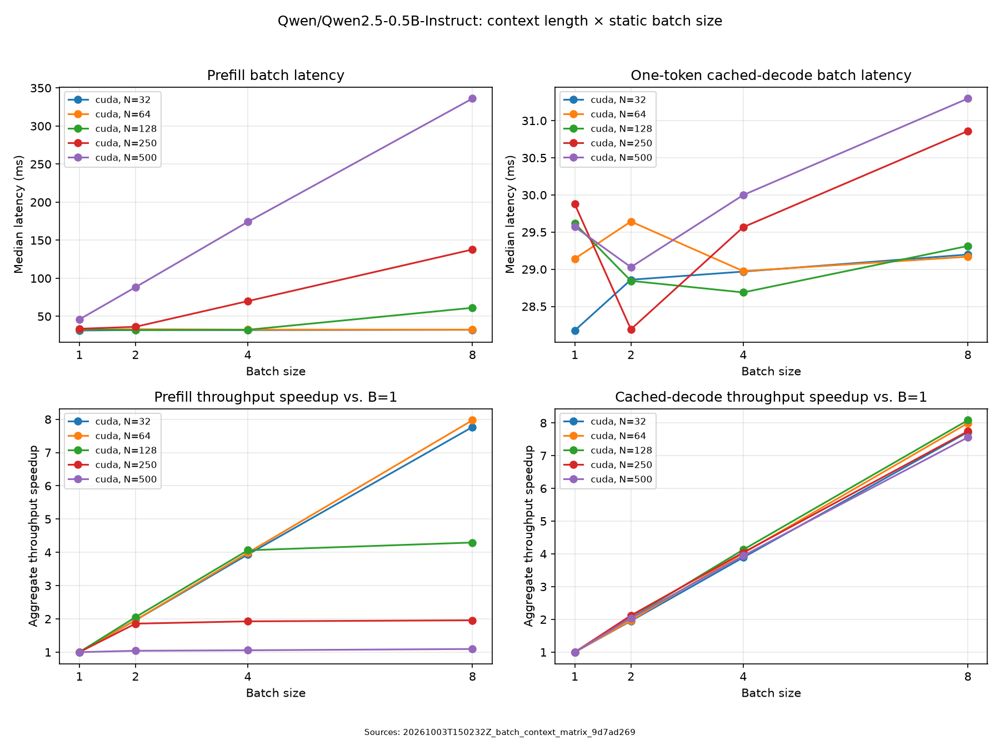

# T4 prefill and decode: context length and batch scaling

**Question:** How do prompt length and batch size change prefill and cached-decode
latency and throughput on one T4?

**Prefill throughput flattens as prompt workloads grow, while one-token cached
decode scales nearly linearly through batch size eight.** This matrix establishes
an initial operating map for the inference workflow. It motivated the
[larger-batch decode study](decode_batch_scaling.md); the resource
mechanism behind the prefill plateau remains unresolved.

Measurements were recorded on October 3, 2026. There is one complete matrix
sweep, with 30 repetitions per phase and point. Those repetitions quantify
within-process spread, rather than variability across independent sweeps.
N is prompt length per request, and B is the number of requests in a static batch.

## Batch scaling



| N | Prefill B=1 latency | Prefill B=4 latency | Prefill B=8 latency | Prefill B=8 speedup | Decode B=8 speedup |
| ---: | ---: | ---: | ---: | ---: | ---: |
| 32 | 31.47 ms | 31.99 ms | 32.42 ms | 7.77× | 7.72× |
| 64 | 32.48 ms | 32.59 ms | 32.59 ms | 7.97× | 7.99× |
| 128 | 32.89 ms | 32.38 ms | 61.25 ms | 4.30× | 8.08× |
| 250 | 33.72 ms | 70.03 ms | 137.82 ms | 1.96× | 7.74× |
| 500 | 46.00 ms | 174.14 ms | 336.08 ms | 1.09× | 7.56× |

At N=128, doubling B=4 to B=8 raises prefill latency from 32.38 to 61.25 ms
and throughput from 15,811 to 16,718 input tokens/s: only a **5.7% gain**.
This brackets a transition to weak throughput growth; the grid does not locate
an exact threshold.

Longer contexts show weak prefill gains at smaller batches. At N=250,
B=2/4/8 achieve 13,769/14,280/14,511 input tokens/s. At N=500, increasing
B=1 to B=8 yields only a 1.095× throughput improvement. For N=32 and 64,
latency barely changes with batch size, allowing approximately linear throughput
growth.

Cached decode continues to benefit from batching. At N=500 its B=1/8 medians
are 29.57/31.30 ms, yielding 7.56× throughput, about 94.5% of ideal linear
scaling. Efficiency is not monotonically worse with N: the slightly superlinear
8.08× result at N=128 and small differences across contexts need independent
replication before a stronger explanation.

## Context scaling at B=1

| N | Prefill latency | Prefill input tokens/s | Decode latency | Decode output tokens/s |
| ---: | ---: | ---: | ---: | ---: |
| 32 | 31.47 ms | 1,017 | 28.18 ms | 35.49 |
| 64 | 32.48 ms | 1,971 | 29.14 ms | 34.31 |
| 128 | 32.89 ms | 3,892 | 29.62 ms | 33.76 |
| 250 | 33.72 ms | 7,413 | 29.88 ms | 33.47 |
| 500 | 46.00 ms | 10,870 | 29.57 ms | 33.82 |

A 15.6× increase in prompt length raises prefill latency 1.46× and decode
latency 1.05×. The nearly flat latency lets prefill input throughput grow with
N while one-token decode throughput stays nearly flat. Changing execution
efficiency can mask growth in work, so these curves do not establish that
context-dependent work is negligible.

## Interpretation and limits

Small workloads may be dominated by fixed overhead or weight access, while
larger prefills expose increasing device execution cost. Amortization, reuse,
parallelism, and shape-dependent kernel choices are competing explanations.
Matched prefill captures would be needed to distinguish them. The later
[B=16/32 decode traces](decode_execution.md) explain an observed
decode execution path and cannot establish the prefill mechanism.

The latency curves alone do not identify compute or bandwidth saturation.

The result is an operating map for one model, runtime, and GPU, using short
contexts and identical repeated requests. A single matrix cannot establish
variation across independent runs or a serving throughput ceiling. Original
capture identities and the selected evidence boundary are documented in
[the artifact guide](../../docs/artifacts.md#what-the-release-includes).

## Workload and timing

| Setting | Value |
| --- | --- |
| Run ID | `20261003T150232Z_batch_context_matrix_9d7ad269` |
| Model | `Qwen/Qwen2.5-0.5B-Instruct` |
| Model and tokenizer revision | `7ae557604adf67be50417f59c2c2f167def9a775` |
| Hardware and precision | Tesla T4, native Linux, CUDA float16 |
| Prompt lengths N | 32, 64, 128, 250, 500 tokens per request |
| Static batch sizes B | 1, 2, 4, 8 identical requests |
| Execution | Eager, uncompiled, SDPA attention, `eval()` / `inference_mode()` |
| Repetitions | Five warm-ups and 30 measured forwards per phase and point |
| Point isolation | Fresh model process per matrix point; both phases measured |
| Original source | `78fb1a83cf4dad51f2877639555467d707fef3dd`, recorded clean |

The [resolved configuration](../published/20261003T150232Z_batch_context_matrix_9d7ad269/config.resolved.json),
[environment](../published/20261003T150232Z_batch_context_matrix_9d7ad269/environment.json), and each child directory's `measurements.csv`
retain the workload and samples. The city-planning prompt is Qwen chat-formatted
and left-truncated to the exact requested length. Each batch repeats that input.

The timer covers synchronized wall-clock model-forward execution, including
host dispatch and waiting for GPU completion. Prefill processes the full prompt,
constructs the KV cache, and projects final-position logits with
`logits_to_keep=1`. Cached decode advances one position per request against a
fresh prompt cache. Model loading, tokenization, input transfer, and preparation
of that decode cache are outside its timer; the decode cache update is inside.

For median latency t in seconds, prefill throughput is B×N/t input tokens/s
and cached-decode throughput is B/t output tokens/s. Speedup is throughput
divided by the B=1 throughput at the same N. These measure isolated forwards;
they do not include request arrivals, queueing, or full generation.

The motivating predictions were that batching could amortize costs or improve
execution efficiency, and longer contexts could expose attention/cache work.
Logical work growth alone does not predict latency: effective execution rates
and fixed costs may change with shape. Curve shape cannot identify a resource
limit.

## Rebuild from samples

From the repository root, render the matrix into a separate output:

```bash
uv run --locked python experiments/plot_batch_context_matrix.py \
  results/published/20261003T150232Z_batch_context_matrix_9d7ad269 \
  --output runs/t4_matrix.png

uv run --locked python experiments/plot_context_scaling.py \
  results/published/20261003T150232Z_batch_context_matrix_9d7ad269 \
  --batch-size 1 --output runs/t4_context_b1.png
```

Both commands read saved samples and emit companion `.sources.json` records.
They require no model execution. The optional context chart is regenerated here;
the release retains its numerical observations in the table above.

The next report uses a fresh decode-only B=8 anchor to investigate
[scaling beyond batch eight](decode_batch_scaling.md), keeping that
different phase history separate from this matrix.
